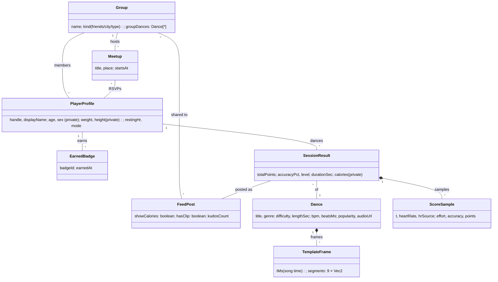

# PULSE — Requirements

Derived from the main spec tab (Description.md in the repo). Where they disagree, the spec wins and this tab gets fixed.

## 1. Method, scope and actors

### Method

- **IDs:** UR (user requirement), FR (functional), NFR (non-functional), SR (system/constraint), UC (use case). IDs never get reused; dropped items are struck, not renumbered.
- **Priority (MoSCoW):** **Must** = needed for the demo; **Should** = Secondary features, build after all Musts pass; **Could** = only if time allows; **Won't** = out of scope this weekend.
- **Every FR has an acceptance criterion** so whoever builds it knows when it's done, and whoever tests it knows what to check.
- **Flow:** UR (what users need) → FR (what the system does) → NFR/SR (how well, and under what constraints) → use cases (how it plays out) → domain model (the data) → traceability (every UR covered).

### Scope

| In scope (this weekend) | Out of scope (Won't) |
| --- | --- |
| Single-player dancing with a silhouette coach, template-based accuracy, heart-rate effort, points | Several people on one camera |
| Seated mode | Apple Watch, WHOOP/Garmin cloud APIs |
| WHOOP/Garmin live heart rate over Web Bluetooth, simulated fallback | Backend, real accounts across devices |
| Catalogue with Popular and For you, results, private calories | Creator-recorded routines, recommendation engine |
| Profile, feed, kudos, groups (weekly dance, leaderboards) on seeded data | Paid features |
| Badges and highlight clip (Should) | In-dance adaptation, turn-taking, Shared Chorus (dropped) |

### Actors

| Actor | Type | Description |
| --- | --- | --- |
| Dancer | Primary | Anyone using PULSE to dance, track effort and post results |
| Seated dancer | Primary (specializes Dancer) | Wheelchair user or person with limited mobility, using seated mode |
| Group member | Primary (specializes Dancer) | A dancer who joins groups, does group dances and checks leaderboards |
| Team (content author) | Secondary | Runs the template extract tool to add dances; seeds demo data |
| Heart-rate wearable | External system | WHOOP or Garmin broadcasting heart rate over Bluetooth |
| Webcam | External system | Laptop or phone camera feeding pose detection |

### Stakeholders

Dancers and seated dancers (fun, fair scoring, privacy), the 4-person team (buildable by Sunday noon), and CodeJam judges, mostly IBM sales reps (a clear, working, honest demo).

## 2. User requirements (UR)

What users need, in their terms. Each is satisfied by the FRs listed in section 8.

| ID | Actor | Requirement | Priority |
| --- | --- | --- | --- |
| UR-01 | Dancer | Set up a profile with my body stats and standing or seated mode, and know my body stats stay private | Must |
| UR-02 | Dancer | Connect my WHOOP or Garmin and see my live heart rate | Must |
| UR-03 | Dancer | Browse dances, sort by difficulty, and see what's popular and what fits my level | Must |
| UR-04 | Dancer | Follow a coach dancing to the song in front of my camera | Must |
| UR-05 | Dancer | See live feedback while dancing: how well I'm following, my points and my heart rate | Must |
| UR-06 | Seated dancer | Dance seated and be scored fairly on upper-body movement | Must |
| UR-07 | Dancer | Pause at any time without losing my progress | Must |
| UR-08 | Dancer | See my results after a dance: points, accuracy level, time and calories | Must |
| UR-09 | Dancer | Post my results to my profile and groups, choosing what to share | Must |
| UR-10 | Dancer | See friends' posts and give kudos | Must |
| UR-11 | Group member | Join groups, do the group dance and compare on a weekly leaderboard | Must |
| UR-12 | Dancer | Be sure no video of me is stored or leaves my device | Must |
| UR-13 | Dancer | Earn badges for achievements | Should |
| UR-14 | Dancer | Share a short silhouette highlight clip of my dance | Should |
| UR-15 | Team | Add a new dance to the catalogue from a video | Must |

## 3. Functional requirements (FR)

Grouped by subsystem, so each group maps to one module and can be built in parallel. ⚑ = a detail the spec didn't state, filled in here; review these.

### 3.1 Profile

| ID | The system shall… | Priority | Acceptance criterion |
| --- | --- | --- | --- |
| FR-01 | Let the user create and edit a profile: handle, display name, age, sex (male/female/other), weight, height, resting heart rate, standing/seated mode, optional HRmax override | Must | Profile survives a page reload; empty resting heart rate saves as 65 |
| FR-02 | Treat age, sex, weight, height and heart-rate data as private, never included in a post | Must | No FeedPost object contains any of these fields |
| FR-03 | Let several local profiles exist and switch the active one | Should | Two teammates can each dance under their own profile on one laptop |

### 3.2 Wearable

| ID | The system shall… | Priority | Acceptance criterion |
| --- | --- | --- | --- |
| FR-04 | Connect to a heart-rate device via Web Bluetooth (service `0x180D`, characteristic `0x2A37`), started by a user click | Must | Live BPM appears after pairing a WHOOP or Garmin in broadcast mode (to verify Saturday) |
| FR-05 | Read 8-bit or 16-bit BPM according to bit 0 of the flags byte | Must | Unit test passes for both packet formats |
| FR-06 | Show the heart-rate source and connection state; show a "Reconnect your watch" banner when the connection drops | Must | Turning the watch off mid-dance shows the banner, no crash |
| FR-07 | After a drop, hold the last effort value for 10 s, then use 0 | Must | Effort curve in the session data shows the 10 s hold, then 0 |
| FR-08 | Offer a simulated heart-rate source, labeled "Simulated" everywhere it appears | Must | Every screen showing simulated BPM shows the label |

### 3.3 Catalogue

| ID | The system shall… | Priority | Acceptance criterion |
| --- | --- | --- | --- |
| FR-09 | Show dance cards with title, genre, difficulty and length | Must | All 2–3 demo dances appear with all four fields |
| FR-10 | Sort and filter dances by difficulty | Must | Choosing "hard" shows only hard dances |
| FR-11 | Show a Popular tab sorted by popularity | Must | Order matches the popularity values |
| FR-12 | Show a For you tab: average accuracy over the last 3 dances ≥ 80% → next difficulty up; < 50% → next down; else same; then sort by popularity. ⚑ With 1–2 dances, average what exists; with none, show the Popular list. ⚑ #112: the down threshold is 66% (`CONFIG.forYou.downPct` = `level.silver`), since beat-based accuracy runs higher | Must | Unit tests cover 0, 1 and 3+ dance histories at each threshold |

### 3.4 Dance templates

| ID | The system shall… | Priority | Acceptance criterion |
| --- | --- | --- | --- |
| FR-13 | Provide a dev tool page (/dev/extract) that turns a dance video into a Dance JSON using the same pose engine and segment code as live scoring: per frame, song time and the 9 segment directions (missing when visibility < 0.55) | Must | Tool output loads in the app and the coach replays the dance |
| FR-14 | ⚑ Take BPM and first-beat offset as manual script inputs and compute all beat times from them | Must | Coach beats line up with the song by ear |
| FR-15 | Store dance metadata (title, genre, difficulty, length, popularity) and the song audio with each dance | Must | Catalogue reads all metadata from the dance files |

### 3.5 Vision

| ID | The system shall… | Priority | Acceptance criterion |
| --- | --- | --- | --- |
| FR-16 | Load MediaPipe Pose Landmarker ≥ 0.10.11 (lite model) from local files in VIDEO mode with 1 pose | Must | Works with Wi-Fi off; `visibility` is a number on every landmark |
| FR-17 | Run detection only on new camera frames (`requestVideoFrameCallback`) | Must | Detection count per second ≤ camera FPS |
| FR-18 | Smooth each landmark coordinate with a One Euro filter (`mincutoff` 1.0 Hz, `beta` 0.03) | Must | A dancer standing still shows no visible skeleton jitter |
| FR-19 | Compute the 9 segment directions as 2D unit vectors and mirror the user (x → 1 − x, swap left/right) | Must | Raising your right arm matches the coach raising the arm on the same side of the screen |
| FR-20 | In seated mode, use only the 5 upper-body segments | Must | Hiding the legs under a desk doesn't change the seated score |
| FR-21 | Skip a segment when either landmark's visibility < 0.55. ⚑ If fewer than half the mode's segments are usable, show "Tracking uncertain — keep moving" | Must | Covering the camera shows the message and points don't drop |
| FR-22 | Ignore frames where the body center jumps more than 0.35 of screen width (background lock) | Should | Someone walking behind the dancer doesn't take over tracking |
| FR-23 | Show a get-ready screen with camera preview and skeleton overlay | Must | User can check framing before pressing Start |

### 3.6 Audio and sync

| ID | The system shall… | Priority | Acceptance criterion |
| --- | --- | --- | --- |
| FR-24 | Play the song through Web Audio, started by a user click, using `AudioContext.currentTime` as the master clock | Must | No timers drive beats or the coach |
| FR-25 | Convert each camera frame's timestamp to heard song time via `getOutputTimestamp` (camDelay 0.045 s to start), with the fallback when unavailable | Must | Logged song times increase smoothly and match the audio |
| FR-26 | Draw the silhouette coach from the template frame at the current song time | Must | Coach stays in time with the music for the whole song |

### 3.7 Scoring

| ID | The system shall… | Priority | Acceptance criterion |
| --- | --- | --- | --- |
| FR-27 | Score each frame against templates from t − 240 ms to t + 120 ms. ⚑ #112: segment score is 1 up to `CONFIG.fullScoreDeg` (10°), then linear to 0 at `CONFIG.toleranceDeg` (40°). Seated uses `CONFIG.seatedCurve` (25° / 60°, NFR-08). ⚑ #147 and #148: require at least half the mode's segments in both poses. Use the best sum of segment scores divided by the largest shared segment count among eligible templates. The rolling 2 s average uses scores since the last confirmed still second. | Must | Copying the coach well scores clearly higher than random movement |
| FR-28 | Rate each beat Perfect ≥ 0.85, Good ≥ 0.65, OK ≥ 0.4, else Miss, and show it as a pop-up. ⚑ #112: use the mean of the best half of frame scores between this beat and the next. Suppress pop-ups during confirmed stillness and for beats without a usable score. ⚑ #147: close beats on the heard-song timeline with an allowance for in-flight camera frames. | Must | Pop-ups appear on the beat during the dance |
| FR-29 | Compute effort per second from heart-rate reserve (HRmax = 208 − 0.7 × age or the override; HRrest from profile) with the TRIMP weighting for the user's sex | Must | Unit test matches hand-calculated values |
| FR-30 | Award points each second using the rolling accuracy ramp, which goes from 0 at 0.45 to 1 at 0.85. A watch session awards 10 × effort × (0.2 + 0.8 × ramp(acc)) and a no-watch session awards 8 × ramp(acc). Confirmed stillness earns zero (#112). Hold the last confident accuracy during tracking loss for up to 3 s of song time. Accuracy and points are zero after expiry and before the first confident frame (#85). Effort, HR and calories still record in watch sessions. | Must | Unit tests cover the points formulas, short tracking loss, and zero points for an empty frame or confirmed stillness. |
| FR-31 | Compute final accuracy as the mean of beat scores. Confirmed still beats and untracked beats past the hold count zero. Levels are Superstar ≥ 85%, Gold ≥ 70%, Silver ≥ 66%, otherwise Bronze (`CONFIG.level`, #112). | Must | Unit test on the thresholds |
| FR-32 | Estimate calories per minute with the Keytel formula (average of both for "other") | Must | Unit test matches hand-calculated values |
| FR-33 | Show a live HUD: coach, beat ratings, points, heart rate with source, small skeleton, Pause | Must | All elements readable from 2–3 m |

### 3.8 Dance session

| ID | The system shall… | Priority | Acceptance criterion |
| --- | --- | --- | --- |
| FR-34 | Pause and resume with a button or the spacebar, keeping points so far | Must | Points before and after a pause are identical |
| FR-35 | End the session when the song ends and go to results. ⚑ Quitting early shows time and calories only: no points, no level, no badges, can't be posted, and doesn't count for leaderboards or For you | Must | Finishing shows full results; quitting shows only time and calories, with no Post button |

### 3.9 Results

| ID | The system shall… | Priority | Acceptance criterion |
| --- | --- | --- | --- |
| FR-36 | Show points, accuracy %, level badge, duration and calories (labeled private and estimated) | Must | All five shown after every dance |
| FR-37 | Save every completed session result to the user's history (quit sessions keep time and calories only) | Must | History survives a reload and feeds For you (FR-12) |

### 3.10 Social feed

| ID | The system shall… | Priority | Acceptance criterion |
| --- | --- | --- | --- |
| FR-38 | Let the user post a result to their profile and chosen groups, with toggles for calories (default off), average heart rate (default off) and clip (default off), with a live preview of the post | Must | Post shows exactly what was toggled; only the opt-in average BPM, never raw heart rate |
| FR-39 | Show a feed of seeded and user posts, newest first | Must | A new post appears at the top |
| FR-40 | Let a user give kudos once per post (toggle) | Must | Count goes up once, down on second tap |
| FR-41 | Show a profile page with the user's posts, badges and totals | Must | Page reflects a new post immediately |

### 3.11 Groups

| ID | The system shall… | Priority | Acceptance criterion |
| --- | --- | --- | --- |
| FR-42 | List seeded groups by kind (friends, city, dance type) and let the user join or leave | Must | Joining adds the group to the profile |
| FR-43 | Show each group's feed (posts shared to it) | Must | Posting to a group shows it there |
| FR-44 | Show a weekly leaderboard per group dance. ⚑ Each member's best points that week, weeks run Monday–Sunday local time | Must | A new high score moves the user up |
| FR-45 | ⚑ Removed from the UI (team review 2026-11-22): group meetups and RSVP. The group page leads with its weekly dance and Start shortcut instead; seeded meetup data is kept | Won't | — |

### 3.12 Badges

| ID | The system shall… | Priority | Acceptance criterion |
| --- | --- | --- | --- |
| FR-46 | Award each badge once when its rule is met, show it on the results screen when new, and on the profile. Rules: First Steps (1st dance), On Fire (⚑ a finished dance on 3 consecutive calendar days), Superstar, 1K Club, Crew Player, Podium | Should | Each rule tested with a fixture history |

### 3.13 Highlight clip

| ID | The system shall… | Priority | Acceptance criterion |
| --- | --- | --- | --- |
| FR-47 | Record the 12 landmarks as 2D points at 10–12 FPS during the dance, centered on the torso and scaled by shoulder width | Should | About 15 KB per 30 s stored |
| FR-48 | Pick the highest-scoring window. ⚑ Default length 15 s | Should | Clip covers the best-scoring stretch |
| FR-49 | Render a 9:16 silhouette replay at 60 FPS (interpolated), fading low-visibility limbs | Should | Replay is smooth and has no twitching limbs |
| FR-50 | Export the clip with the song as WebM (MP4 where supported) via `MediaRecorder` | Could | Downloaded file plays in a browser |

### 3.14 Data

| ID | The system shall… | Priority | Acceptance criterion |
| --- | --- | --- | --- |
| FR-51 | Store all user and social data in localStorage behind one data module, loading seeded demo data on first run; dances are loaded from public/dances/ into memory, never into localStorage | Must | Fresh browser shows seeded feed, groups and meetups; no storage quota errors |
| FR-52 | Offer a "Reset demo data" action | Should | One click restores the seeded state |

## 4. Non-functional requirements (NFR)

How well the system must work. Targets come from the spec and the team's research docs; all are checked on the demo laptop.

| ID | Category | Requirement | Priority | How we verify |
| --- | --- | --- | --- | --- |
| NFR-01 | Performance | Pose detection plus rendering runs at ≥ 24 FPS | Must | FPS counter during a full dance |
| NFR-02 | Sync | Coach and audio stay aligned within 25 ms over a whole song | Must | Watch and listen at the last chorus; compare logged times |
| NFR-03 | Responsiveness | A beat's rating appears within 300 ms after that beat | Should | Timestamp log of beat vs pop-up |
| NFR-04 | Offline | After the page loads, nothing needs the network (model, WASM, audio, dances, seed data all local) | Must | Full demo with Wi-Fi off |
| NFR-05 | Privacy | Camera frames are never stored or sent; body stats and raw heart rate never appear in posts (only an opt-in average BPM) | Must | Code review + inspect localStorage and network tab |
| NFR-06 | Usability | A new user goes from catalogue to dancing in under 60 s | Must | Timed run with a teammate who didn't build it |
| NFR-07 | Usability | Dance screen text readable from 2–3 m | Must | Check from across the room |
| NFR-08 | Accessibility | A seated dancer following the coach well reaches the same level band as a standing dancer doing the same | Must | Same teammate, standing vs seated, on one dance. ⚑ #87: the recorded Tip Toe live baseline reached Silver in both modes. The #148 offline delayed-follower replay reached Gold or better on all four dances in both modes. |
| NFR-09 | Honesty | Simulated heart rate always labeled "Simulated"; calories always labeled "estimated"; no medical claims | Must | Screen-by-screen check |
| NFR-10 | Tone | Feedback is encouraging; no shaming messages | Must | Review all on-screen strings |
| NFR-11 | Reliability | The full demo runs twice in a row without crashing; watch disconnect and camera loss never crash the session | Must | Two back-to-back runs, plus pulling the watch and covering the camera |
| NFR-12 | Maintainability | Strict TypeScript; shared types in `src/types/pulse.ts`; all storage behind one data module so a backend can replace it later | Must | `tsc --noEmit` passes; no direct localStorage calls outside the module |

## 5. System requirements and constraints (SR)

Fixed conditions the build must respect.

| ID | Constraint |
| --- | --- |
| SR-01 | **Hardware:** laptop with a 720p, 30 FPS webcam and WebGL 2 support |
| SR-02 | **Browser:** desktop Chrome or Edge 120+ (Web Bluetooth, `requestVideoFrameCallback`, `getOutputTimestamp`). Android Chrome works; iPhone browsers can't connect watches (no Web Bluetooth) |
| SR-03 | **Secure context:** served from `localhost` or HTTPS, required for both camera and Web Bluetooth |
| SR-04 | **Stack:** Node 20+, Vite, React 18+, TypeScript 5 in strict mode |
| SR-05 | **Vision:** `@mediapipe/tasks-vision` ≥ 0.10.11; `pose_landmarker_lite.task` and WASM files in `public/` |
| SR-06 | **Assets:** 2–3 dance JSON files with their song audio, plus seed data, in `public/` |
| SR-07 | **Heart-rate device:** WHOOP with Broadcast Heart Rate on, or a Garmin model that broadcasts heart rate over Bluetooth (ANT+ only won't work) |
| SR-08 | **Hackathon rules:** no code written before Friday 7:00 PM; final push to GitHub before Sunday 12:00 PM, no edits after; AI-assisted work disclosed in the README |

## 6. Use cases

### Use-case list

| ID | Use case | Primary actor | Other actors | Priority | Covers |
| --- | --- | --- | --- | --- | --- |
| UC-01 | Set up profile | Dancer | — | Must | UR-01 |
| UC-02 | Connect watch | Dancer | Heart-rate wearable | Must | UR-02 |
| UC-03 | Choose a dance | Dancer | — | Must | UR-03 |
| UC-04 | Dance a session | Dancer | Webcam, wearable | Must | UR-04, 05, 07, 08 |
| UC-05 | Dance seated | Seated dancer | Webcam, wearable | Must | UR-06 |
| UC-06 | Post a result | Dancer | — | Must | UR-09 |
| UC-07 | Browse feed and give kudos | Dancer | — | Must | UR-10 |
| UC-08 | Join a group and check the leaderboard | Group member | — | Must | UR-11 |
| UC-09 | ~~RSVP to a meetup~~ (removed 2026-11-22) | Group member | — | Won't | UR-11 |
| UC-10 | Share a highlight clip | Dancer | — | Should | UR-14 |
| UC-11 | Add a dance | Team | — | Must | UR-15 |

UC-05 is UC-04 with seated mode on; badges (UR-13) are awarded inside UC-04's results step.

### UC-04: Dance a session

- **Actors:** Dancer (primary); webcam, heart-rate wearable
- **Preconditions:** an active profile; a dance chosen (UC-03); camera permission granted
- **Main flow:**
    1. Dancer opens the get-ready screen; the camera preview and skeleton appear.
    2. Dancer checks framing and presses Start.
    3. The song starts; the silhouette coach dances in time with it.
    4. Every frame, the system scores the dancer's pose against the template; every beat, it shows a rating; every second, it adds points from effort and accuracy.
    5. The HUD shows points, heart rate (with source) and ratings throughout.
    6. The song ends; the system shows results (points, accuracy level, time, calories) and any new badges.
    7. The result is saved to history.
- **Alternate flows:**
    - 2a. Camera permission denied: show how to enable it; Start stays disabled.
    - 4a. Tracking uncertain: show "Tracking uncertain — keep moving"; points keep accruing with the last confident accuracy.
    - 4b. Watch disconnects: show "Reconnect your watch"; effort holds 10 s, then 0; the dance continues.
    - 4c. No watch connected: simulated heart rate, labeled "Simulated".
    - 4d. Dancer pauses (button or spacebar): song and scoring stop; Resume continues with points kept.
    - 4e. Dancer quits early: show time and calories only; no points, level, badges or posting.
- **Postconditions:** a SessionResult saved; For you and badges updated.

### UC-02: Connect watch

- **Actors:** Dancer; heart-rate wearable
- **Preconditions:** watch in broadcast mode; Chrome or Edge on localhost or HTTPS
- **Main flow:**
    1. Dancer clicks Connect watch.
    2. The browser's device picker lists nearby heart-rate devices; dancer picks theirs.
    3. The system subscribes to heart-rate notifications and shows live BPM with the source.
- **Alternate flows:**
    - 2a. No device found: show the broadcast-mode instructions for WHOOP and Garmin, and offer simulated heart rate.
    - 3a. Browser without Web Bluetooth (e.g. iPhone): explain and offer simulated heart rate.
- **Postconditions:** live heart rate available to scoring.

### UC-06: Post a result

- **Actors:** Dancer
- **Preconditions:** on the results screen of a finished dance
- **Main flow:**
    1. Dancer presses Post.
    2. Dancer picks groups and sets the calories and clip toggles (both off by default).
    3. The system creates the post on the profile and in the chosen groups; group leaderboards update if it was a group dance.
- **Alternate flows:**
    - 2a. Clip toggle on (Should): the system generates the 15 s highlight from the best-scoring window.
- **Postconditions:** post visible at the top of the feed, without body stats or heart rate.

### UC-11: Add a dance

- **Actors:** Team
- **Main flow:**
    1. Team picks a clean, front-facing solo dance video.
    2. Opens the extract tool (/dev/extract) with the video, BPM, first-beat offset and metadata.
    3. The tool outputs the Dance JSON (audio extracted once with ffmpeg) into `public/`.
    4. The dance appears in the catalogue; the team checks the coach replay against the song.
- **Alternate flows:**
    - 2a. Coach poorly detected (outfit, camera angle): choose another video.

## 7. Domain model

The entities match the data contract in the spec (`src/types/pulse.ts`). A filled diamond means the part only exists inside its owner (a dance's frames, a session's samples).

SessionResult is the hub: one player dances one dance, producing per-second samples, and can be posted once. Private fields never travel into a FeedPost.

## 8. Traceability

Every UR is covered by at least one FR or NFR, and every FR traces back to a UR. No gaps.

| UR | Satisfied by | Use case |
| --- | --- | --- |
| UR-01 Profile, private stats | FR-01, FR-02, FR-03 | UC-01 |
| UR-02 Connect watch | FR-04 to FR-08 | UC-02 |
| UR-03 Browse dances | FR-09 to FR-12 | UC-03 |
| UR-04 Follow a coach | FR-16 to FR-19, FR-23 to FR-26 | UC-04 |
| UR-05 Live feedback | FR-21, FR-22, FR-27, FR-28, FR-30, FR-33 | UC-04 |
| UR-06 Seated, fair scoring | FR-20, NFR-08 | UC-05 |
| UR-07 Pause | FR-34 | UC-04 |
| UR-08 Results | FR-29, FR-31, FR-32, FR-35 to FR-37 | UC-04 |
| UR-09 Post results | FR-38, FR-41 | UC-06 |
| UR-10 Feed and kudos | FR-39, FR-40 | UC-07 |
| UR-11 Groups | FR-42 to FR-45 | UC-08, UC-09 |
| UR-12 No video stored | FR-02, FR-47, NFR-05 | all |
| UR-13 Badges | FR-46 | UC-04 |
| UR-14 Highlight clip | FR-47 to FR-50 | UC-10 |
| UR-15 Add a dance | FR-13 to FR-15 | UC-11 |

FR-51 and FR-52 (data storage, demo reset) support every UR rather than one.
